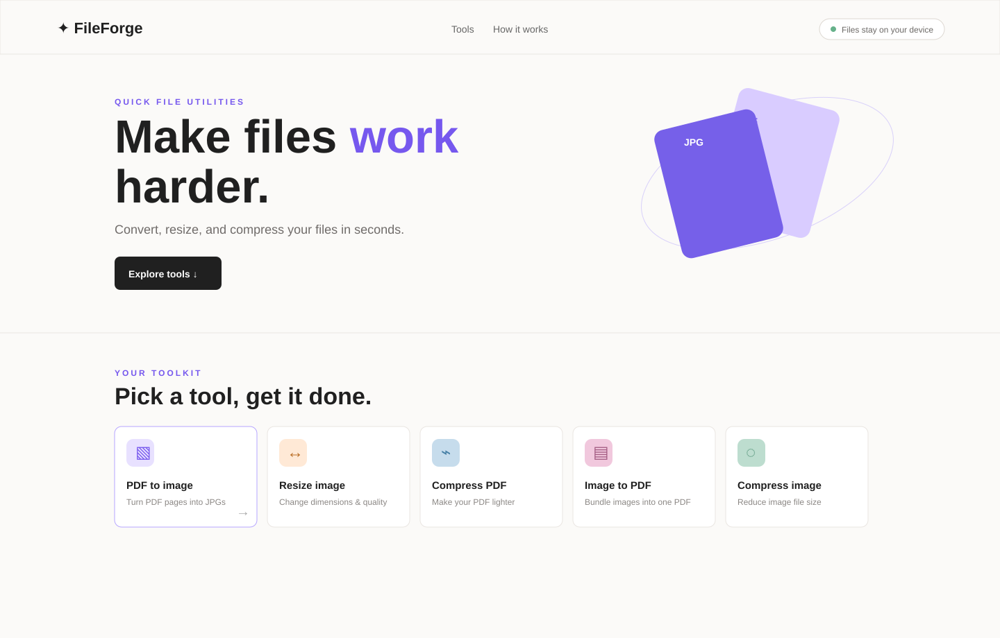

# FileForge

FileForge is a private Windows desktop utility for everyday file conversion. It can convert PDFs to images, combine images into PDFs, resize images, and reduce file sizes.



## Features

- PDF to PNG or JPG images
- Image resize with custom dimensions and quality
- PDF compression
- Multiple images to one PDF
- Image compression
- Drag-and-drop upload queue
- File validation and size limits
- Image thumbnails and live preview
- Downloadable output files
- Local-only processing

## Privacy

FileForge is packaged as an Electron Windows application. PDF.js and jsPDF are bundled with the app, and Electron blocks HTTP/HTTPS requests at runtime. Files are processed in the local app window and are not uploaded to a server.

## Run locally

Install Node.js 20 or newer, then run:

```powershell
npm install
npm start
```

## Build for Windows

```powershell
npm run build
```

The build creates an installable Windows `.exe` and a portable `.exe` inside `dist/`.

## Project files

| File | Purpose |
| --- | --- |
| `index.html` | Application interface |
| `style.css` | Visual design and responsive layout |
| `app.js` | Conversion and upload logic |
| `electron-main.js` | Windows desktop shell and offline network lock |
| `package.json` | Electron dependencies and build scripts |

